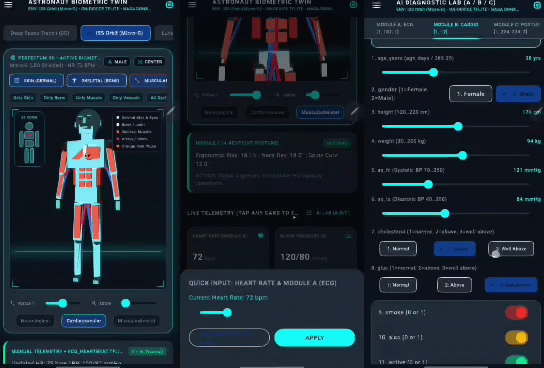

# 🚀 NASA Astronaut Biometric Twin & Autonomous Health Monitoring System

[](https://www.spaceappschallenge.org/2026/challenges/health-monitoring-software/)
[](https://flutter.dev)
[](https://ai.google.dev/edge/litert)
[](https://pub.dev/packages/perfectum_3d)
[](https://ccmc.gsfc.nasa.gov/DONKI/api/)

> **Developed for the 2026 NASA Space Apps Challenge — *"Create Health Monitoring Software for Astronauts on Space Missions"***  
> An offline-first, multi-modal clinical decision support and 3D anatomical visualization workstation engineered for deep-space crew autonomy across Low Earth Orbit (ISS), cislunar space, Lunar surface operations (Artemis), and Martian transit habitats.

---

## System Demonstration & Video Walkthrough



*The GIF above demonstrates the core navigation, UI components , 3D Holographic Biometric Twin, On-Device TFLite/LiteRT Diagnostic Lab, and Live NASA DONKI Space Weather Telemetry.*

</div>

## 1. Executive Summary & Scientific Background

Long-duration human spaceflight beyond Low Earth Orbit (LEO)—such as NASA's **Artemis** lunar campaigns and future crewed **Mars transit missions**—exposes astronauts to extreme physiological and psychological stressors. NASA's **Human Research Program (HRP)** classifies these stressors into the **Five Hazards of Human Spaceflight**:

1. **Space Radiation:** Galactic Cosmic Rays (GCR) and Solar Particle Events (SPE) accelerate endothelial stiffening, radiation-induced cardiovascular disease, and acute cellular damage.
2. **Isolation and Confinement:** Circadian desynchronization, REM sleep deficit, cognitive fatigue, and behavioral health deterioration.
3. **Distance from Earth:** One-Way Light Time (OWLT) communication delays of up to $22\text{ minutes}$ on Mars require **100% autonomous, on-device medical diagnostics** independent of real-time ground flight surgeon intervention.
4. **Altered Gravity Fields ($0\text{G}$, $\frac{1}{6}\text{G}$, $\frac{3}{8}\text{G}$):** Cephalad fluid shifts causing Spaceflight-Associated Neuro-ocular Syndrome (SANS), spherical cardiac remodeling, spinal elongation (up to $5\text{ cm}$), and trabecular bone mineral loss of $1.0\%\text{–}1.5\%$ per month.
5. **Hostile/Closed Environments:** Elevated cabin $\text{CO}_2$, lunar regolith dust inhalation, and spacesuit (EVA) musculoskeletal overload.

**NASA Astronaut Health Monitor** addresses these five hazards by combining a custom-engineered **4-layer 3D Holographic Anatomical Twin** (`perfectum_3d`) with **four on-device machine learning pipelines** (`flutter_litert` & `google_mlkit_face_detection`) and **live solar radiation telemetry** from **NASA's CCMC DONKI API**.

---

## 2. System Architecture & Offline-First Engineering

The software is designed around a **Dual-Redundancy Offline-First Architecture** to guarantee uninterrupted medical evaluation during deep-space communication blackouts:

```text
┌──────────────────────────────────────────────────────────────────────────────┐
│                        FLUTTER MOBILE WORKSTATION (UI)                       │
│  ┌─────────────────────────┐  ┌──────────────────────┐  ┌──────────────────┐ │
│  │ 3D Biometric Twin       │  │ AI Diagnostic Lab    │  │ Countermeasures  │ │
│  │ • perfectum_3d Engine   │  │ • Module A: ECG      │  │ • ARED Protocols │ │
│  │ • 4 Anatomical Layers   │  │ • Module B: Cardio   │  │ • XP Gamification│ │
│  │ • 2D Zoom Mini-Map      │  │ • Module C: Posture  │  │ • Flight Surgeon │ │
│  │ • 3D Ray/Clip Hit-Test  │  │ • Module D: ML Kit   │  │   Emergency Queue│ │
│  └───────────┬─────────────┘  └──────────┬───────────┘  └────────┬─────────┘ │
└──────────────┼───────────────────────────┼───────────────────────┼───────────┘
               │                           │                       │
               ▼                           ▼                       ▼
┌──────────────────────────────────────────────────────────────────────────────┐
│                 ON-DEVICE INFERENCE & TELEMETRY SERVICES                     │
│  ┌─────────────────────────┐  ┌──────────────────────┐  ┌──────────────────┐ │
│  │ LiteRT (.tflite) Runner │  │ NASA CCMC DONKI API  │  │ ML Kit Vision    │ │
│  │ • ecg_heartbeat.tflite  │  │ • /FLR (Solar Flares)│  │ • EMA Smoothing  │ │
│  │ • cardiovascular.tflite │  │ • /SEP (Particles)   │  │ • Eye/Smile/Tilt │ │
│  │ • posture_keypts.tflite │  │ • /GST (Geomagnetic) │  │ • Fatigue &      │ │
│  │ • JSON StandardScaler   │  │ • 7-Day Local Cache  │  │   Stress Index   │ │
│  └─────────────────────────┘  └──────────────────────┘  └──────────────────┘ │
└──────────────────────────────────────────────────────────────────────────────┘
```

---

## 3. Interactive 3D Holographic Biometric Twin (`perfectum_3d`)

At the center of the main dashboard is an interactive 3D anatomical workstation powered by our custom Dart/Flutter 3D rendering library, **[`perfectum_3d`](https://pub.dev/packages/perfectum_3d)**.

### 3.1. Four Distinct Anatomical Systems
Astronauts can toggle, combine, or isolate four anatomical layers in real time:
1. **Dermal Layer (`SKIN` - `#7CE8FF`):** Semi-transparent light-blue holographic epidermis/dermis envelope featuring detailed facial landmarks—including bilateral ocular globes (sclera), dark-blue irises/pupils (for SANS monitoring), supraorbital eyebrow ridges, nasal bridge, labial mouth contour, external ears (auricles), shoulder caps, patellar contours, hands, and feet.
2. **Skeletal & Articular System (`SKELETAL` - `#E6F7FF` & `#80E5FF`):** Cranium, mandible, 18-segment articulated vertebral column (Cervical $\text{C1–C5}$, Thoracic $\text{T1–T8}$, Lumbar $\text{L1–L5}$), sternum, 8 pairs of thoracic ribs, pelvic ring/sacrum, clavicles, scapulae, humeri, radii/ulnae, metacarpals/phalanges, femurs, tibiae, fibulae, tarsals, and spherical synovial joint capsules.
3. **Muscular System (`MUSCULAR` - `#FF6A4A` & `#D8432E`):** Bilateral *pectoralis major*, *deltoids*, *biceps brachii*, *triceps brachii*, *brachioradialis* and forearm flexors, segmented *rectus abdominis*, *external obliques*, *latissimus dorsi*, *gluteus maximus*, *quadriceps* (*rectus femoris*, *vastus*), *hamstrings*, and *gastrocnemius/soleus* complexes.
4. **Vascular & Cardiac System (`VASCULAR` - `#FF2E4C` & `#2979FF`):** Central myocardium/ventricles sphere, ascending and abdominal *aorta*, *superior/inferior vena cava*, bilateral *common carotid arteries*, *internal jugular veins*, *subclavian/brachial/radial arteries*, *cephalic/basilic veins*, and *iliac/femoral/tibial* arterial-venous networks.

### 3.2. Mathematical 3D Projection, Camera Orbit & Clip-Space Picking
The 3D engine utilizes homogeneous coordinates in $\mathbb{R}^4$ via `vector_math_64`. Given spherical camera orbit angles $(\theta_{\text{yaw}}, \phi_{\text{pitch}})$, zoom factor $z_{\text{zoom}}$, and dynamic 3D focus target $\mathbf{t} = (t_x, t_y, t_z)^T$, the camera position $\mathbf{c}$ is computed as:

$$\mathbf{c} = \mathbf{t} + \frac{R_0}{z_{\text{zoom}}} \begin{bmatrix} \cos(\phi_{\text{pitch}})\sin(\theta_{\text{yaw}}) \\ \sin(\phi_{\text{pitch}}) \\ \cos(\phi_{\text{pitch}})\cos(\theta_{\text{yaw}}) \end{bmatrix}, \quad R_0 = 17.8$$

Each triangle face is shaded using Lambertian flat shading against normalized light vector $\hat{\mathbf{L}}$ and clipped against the near frustum plane ($w \ge 0.1$) via the **Sutherland–Hodgman polygon clipping algorithm** before Painter's Algorithm depth sorting. When an astronaut taps the screen at pixel $(s_x, s_y)$, each anatomical node center $\mathbf{p}_{\text{world}}$ is projected into clip space:

$$\mathbf{p}_{\text{clip}} = \mathbf{P}_{\text{proj}} \cdot \mathbf{V}_{\text{view}} \cdot \begin{bmatrix} \mathbf{p}_{\text{world}} \\ 1 \end{bmatrix}, \quad \mathbf{p}_{\text{ndc}} = \frac{1}{w_{\text{clip}}} \begin{bmatrix} x_{\text{clip}} \\ y_{\text{clip}} \\ z_{\text{clip}} \end{bmatrix}$$

### 3.3. 2D Interactive Zoom Mini-Map & Dynamic Risk Highlighting
* **2D Zoom Mini-Map (Top-Left HUD):** A 2D body schematic segmented into *Head*, *Chest/Heart*, *Abdominal Core*, *Right Arm*, *Left Arm*, and *Lower Limbs*. Tapping any segment smoothly translates $\mathbf{t}$ to that anatomical region and adjusts $z_{\text{zoom}}$ for localized inspection.
* **Bright Orange Anomaly Pulse (`#FF6D00` $\leftrightarrow$ `#FFAB00`):** When any physiological metric or AI model output crosses clinical thresholds, the affected 3D anatomical structures and 2D mini-map zones pulse in bright fluorescent orange. Tapping the pulsing structure highlights it in **Selection Yellow (`#FFEA00`)** and displays the real-time diagnostic risk card and NASA countermeasure protocol. Once telemetry returns to nominal ranges, the structures automatically revert to their baseline anatomical colors.

---

## 4. Multi-Modal On-Device AI Diagnostic Engine

All three deep learning models are trained in Python (`ai_engine/notebooks/`) using **TensorFlow / Keras 3.16**, exported with dynamic-range quantization to **TensorFlow Lite (`.tflite`)**, and executed on-device in Flutter via `flutter_litert` (with an optional FastAPI Keras bridge in `ai_engine/ai_server.py`).

### 4.1. Module A: 1D-CNN Single-Lead ECG Arrhythmia Classifier
* **File:** `assets/models/ecg_heartbeat.tflite` (`ecg_heartbeat.keras`)
* **Dataset:** [MIT-BIH Arrhythmia Database (Shayan Fazeli Kaggle Repository)](https://www.kaggle.com/datasets/shayanfazeli/heartbeat) — $109,446$ beats sampled at $125\text{ Hz}$.
* **Input Tensor:** `float32 [1, 187, 1]` representing a single heartbeat padded/resampled to $187$ time steps, min-max normalized to $[0.0, 1.0]$.
* **Architecture:**
  * `Conv1D(32, kernel_size=5, padding='same')` $\rightarrow$ `BatchNormalization` $\rightarrow$ `ReLU` $\rightarrow$ `MaxPooling1D(2)`
  * `Conv1D(64, kernel_size=5, padding='same')` $\rightarrow$ `BatchNormalization` $\rightarrow$ `ReLU` $\rightarrow$ `MaxPooling1D(2)`
  * `Conv1D(128, kernel_size=3, padding='same')` $\rightarrow$ `BatchNormalization` $\rightarrow$ `ReLU`
  * `GlobalAveragePooling1D()` $\rightarrow$ `Dense(64, ReLU)` $\rightarrow$ `Dropout(0.3)` $\rightarrow$ `Dense(5, Softmax)`
* **Class Imbalance Handling:** Trained with square-root damped balanced class weights $w_c = \sqrt{\frac{N}{5 \cdot N_c}}$.
* **Output Tensor & Anomaly Metric:** `float32 [1, 5]` probability distribution over Association for the Advancement of Medical Instrumentation (AAMI) classes:
  * $0 = \text{N}$ (Normal Sinus Beat)
  * $1 = \text{S}$ (Supraventricular Ectopic Beat)
  * $2 = \text{V}$ (Premature Ventricular Contraction / PVC)
  * $3 = \text{F}$ (Fusion Beat)
  * $4 = \text{Q}$ (Unclassified / Radiation Pacing Artifact)
  * **Cardiac Anomaly Score:** $S_{\text{ECG}} = 1.0 - P(\text{Class } 0)$.

### 4.2. Module B: Multi-Layer Perceptron (MLP) Cardiovascular Risk Evaluator
* **Files:** `assets/models/cardiovascular.tflite` & `assets/models/cardiovascular_scaler.json`
* **Dataset:** [Cardiovascular Disease Dataset (Svetlana Ulianova Kaggle Repository)](https://www.kaggle.com/datasets/sulianova/cardiovascular-disease-dataset) — $70,000$ clinical records cleaned for physiological bounds ($70 \le \text{AP}_{\text{hi}} \le 250$, $40 \le \text{AP}_{\text{lo}} \le 200$, $\text{AP}_{\text{hi}} > \text{AP}_{\text{lo}}$).
* **Input Tensor:** `float32 [1, 12]` standardized feature vector. Exact feature ordering is enforced between Python and Dart:
  1. `age_years` ($\text{age}_{\text{days}} / 365.25$)
  2. `gender` ($1 = \text{Female}, 2 = \text{Male}$)
  3. `height` ($\text{cm}$)
  4. `weight` ($\text{kg}$)
  5. `ap_hi` (Systolic Blood Pressure in $\text{mmHg}$)
  6. `ap_lo` (Diastolic Blood Pressure in $\text{mmHg}$)
  7. `cholesterol` ($1 = \text{Normal}, 2 = \text{Above Normal}, 3 = \text{Well Above Normal}$)
  8. `gluc` ($1 = \text{Normal}, 2 = \text{Above Normal}, 3 = \text{Well Above Normal}$)
  9. `smoke` ($0 \text{ or } 1$)
  10. `alco` ($0 \text{ or } 1$)
  11. `active` ($0 \text{ or } 1$)
  12. `bmi` ($\text{Body Mass Index} = \frac{\text{weight}_{\text{kg}}}{(\text{height}_{\text{m}})^2}$)
* **On-Device Z-Score Standardization:**
  $$z_i = \frac{x_i - \mu_i}{\sigma_i}, \quad \forall i \in \{0, \dots, 11\}$$
  where $\boldsymbol{\mu}$ and $\boldsymbol{\sigma}$ are loaded directly from `cardiovascular_scaler.json`.
* **Architecture:** `Input(12)` $\rightarrow$ `Dense(64, ReLU)` $\rightarrow$ `BatchNormalization` $\rightarrow$ `Dropout(0.3)` $\rightarrow$ `Dense(32, ReLU)` $\rightarrow$ `Dropout(0.2)` $\rightarrow$ `Dense(1, Sigmoid)`.
* **Output Tensor:** `float32 [1, 1]` yielding $R_{\text{cardio}} \in [0.0, 1.0]$.

### 4.3. Module C: MobileNetV2-0.35 Microgravity Spinal & Posture Regressor
* **File:** `assets/models/posture_keypoints.tflite` (`posture_keypoints.keras`)
* **Dataset:** [Posture Keypoints Detection Dataset (Melsmm Kaggle Repository)](https://www.kaggle.com/datasets/melsmm/posture-keypoints-detection) — YOLO-pose side-profile images with $K=4$ spinal keypoints: $\mathbf{p}_0$ (ear/head), $\mathbf{p}_1$ (upper back/shoulder), $\mathbf{p}_2$ (mid-back), and $\mathbf{p}_3$ (lower back).
* **Rotation-Invariant Biomechanical Risk Target:** Because "vertical" is undefined in $0\text{G}$ microgravity, the training target is derived from intrinsic inter-segmental angles between vectors $\mathbf{u}$ and $\mathbf{v}$:
  $$\theta(\mathbf{u}, \mathbf{v}) = \arccos\left(\text{clip}\left(\frac{\mathbf{u} \cdot \mathbf{v}}{\|\mathbf{u}\|\|\mathbf{v}\| + 10^{-6}}, -1, 1\right)\right) \cdot \frac{180}{\pi}$$
  $$\theta_{\text{neck}} = \theta(\mathbf{p}_1 - \mathbf{p}_3, \mathbf{p}_0 - \mathbf{p}_1), \quad \theta_{\text{spine}} = \theta(\mathbf{p}_2 - \mathbf{p}_3, \mathbf{p}_1 - \mathbf{p}_2)$$
  $$R_{\text{posture}} = 0.5 \cdot \text{clip}\left(\frac{\theta_{\text{neck}} - 15^\circ}{45^\circ - 15^\circ}, 0, 1\right) + 0.5 \cdot \text{clip}\left(\frac{\theta_{\text{spine}} - 10^\circ}{35^\circ - 10^\circ}, 0, 1\right)$$
* **Input Tensor & Architecture:** Live camera photos are decoded and resized to `float32 [1, 224, 224, 3]` with raw pixel values in $[0.0, 255.0]$. An in-graph `Rescaling(1/127.5, offset=-1)` layer normalizes pixels to $[-1, 1]$ before passing through `MobileNetV2(alpha=0.35)` $\rightarrow$ `GlobalAveragePooling2D` $\rightarrow$ `Dropout(0.3)` $\rightarrow$ `Dense(1, Sigmoid)`.

### 4.4. Module D: On-Device Facial Affective & Neurological Fatigue Analyzer
* **File:** `lib/services/face_emotion_service.dart`
* **Engine:** Google ML Kit Face Detection (`google_mlkit_face_detection`) operating in offline mode.
* **Signal Processing:** Extracts smiling probability $p_{\text{smile}}$, bilateral eye-open probabilities $p_{\text{eye}} = \frac{p_{\text{left}} + p_{\text{right}}}{2}$, and 3D head Euler angles $(\psi_x, \psi_y, \psi_z)$. To prevent single-frame blink artifacts, an **Exponential Moving Average (EMA)** filter with smoothing factor $\alpha = 0.2$ is applied:
  $$\hat{x}_t = \hat{x}_{t-1} + \alpha (x_t - \hat{x}_{t-1})$$
* **Neurological Stress & Fatigue Index:**
  $$F_{\text{fatigue}} = \text{clip}(1.0 - \hat{p}_{\text{eye}}, 0, 1), \quad H_{\text{offset}} = \text{clip}\left(\frac{\max(|\psi_x|, |\psi_y|, |\psi_z|)}{40^\circ}, 0, 1\right)$$
  $$S_{\text{neuro}} = \text{clip}\left(0.4(1.0 - \hat{p}_{\text{smile}}) + 0.4 F_{\text{fatigue}} + 0.2 H_{\text{offset}}, 0, 1\right)$$

---

## 5. Live Space Weather Telemetry: NASA CCMC DONKI API Integration

Implemented in `lib/services/nasa_space_weather_service.dart`, the application queries **NASA's Space Weather Database Of Notifications, Knowledge, Information (DONKI)** operated by the **Community Coordinated Modeling Center (CCMC)** at NASA Goddard Space Flight Center.

* **Base Endpoint:** `https://ccmc.gsfc.nasa.gov/DONKI-API/get` *(No API key required)*
* **Monitored Space Weather Streams (7-Day Rolling Window):**
  1. **`/FLR` (Solar Flares):** Parses X-ray flare classifications ($\text{A, B, C, M, X}$) and ranks peak intensity using a logarithmic-scale flare score.
  2. **`/SEP` (Solar Energetic Particle Events):** Detects high-energy proton storms that pose immediate acute radiation sickness (ARS) hazards to crew outside Earth's magnetosphere.
  3. **`/GST` (Geomagnetic Storms):** Tracks magnetospheric disturbances affecting orbital stations.
* **Dynamic Radiation Multiplier & Offline Caching:**
  The baseline daily radiation dose $D_{\text{env}}$ of the selected mission environment is modulated in real time by the DONKI multiplier $M_{\text{DONKI}} \in \{1.0, 1.15, 1.2, 1.4, 1.6\}$:
  $$D_{\text{live}} = D_{\text{env}} \times M_{\text{DONKI}} \quad [\text{mSv/day}]$$
  Every complete response is serialized to `nasa_donki_cache.json` on the device. If the spacecraft loses telemetry link, the software seamlessly falls back to the cached snapshot (`NASA DONKI CACHED`) for up to 7 days.

---

## 6. Mission Environments, Gamified Countermeasures & Clinical Protocols

* **Multi-Environment Selector:** Crew members switch between four calibrated mission profiles:
  * **ISS Orbit (Micro-G):** $0.42\text{ mSv/d}$ baseline, magnetosphere shielded, active trabecular bone loss.
  * **Deep Space Transit ($0\text{G}$):** $1.15\text{ mSv/d}$ baseline, unshielded Galactic Cosmic Rays (GCR) + severe cephalad fluid shift.
  * **Lunar Surface ($\frac{1}{6}\text{G}$):** $0.68\text{ mSv/d}$ baseline, solar particle event (SPE) exposure + lunar regolith & EVA suit lumbar strain.
  * **Mars Habitat ($\frac{3}{8}\text{G}$):** $0.54\text{ mSv/d}$ baseline, atmospheric partial shielding + $20\text{-minute}$ OWLT comm delay requiring autonomous AI triage.
* **Gamified Countermeasure Adherence:** Tracks daily completion of **ARED (Advanced Resistive Exercise Device)** squats/deadlifts, 187-sample ECG screening, 4-keypoint posture checks, and circadian blue-light therapy, rewarding the crew with XP levels to combat isolation-induced apathy.
* **Emergency Flight Surgeon Packet Queue:** A dedicated high-priority alert action (`ALERT FLIGHT SURGEON`) packages current 3D anatomical anomalies and AI probabilities for asynchronous downlink.

---

## 7. Datasets, NASA Resources & Scientific References

| Resource / Dataset | Provider / Author | Usage in Project | Official Link |
| :--- | :--- | :--- | :--- |
| **NASA Space Apps 2026 Challenge** | NASA Science Mission Directorate | Challenge Objectives & Requirements | [Health Monitoring Software Challenge](https://www.spaceappschallenge.org/2026/challenges/health-monitoring-software/) |
| **NASA CCMC DONKI API** | NASA Goddard Space Flight Center | Live Solar Flare (`/FLR`), Particle (`/SEP`), and Storm (`/GST`) Telemetry | [https://ccmc.gsfc.nasa.gov/DONKI/api/](https://ccmc.gsfc.nasa.gov/DONKI/api/) |
| **MIT-BIH Heartbeat Dataset** | Shayan Fazeli / PhysioNet | Module A: 187-Sample 1D-CNN ECG Classifier | [Kaggle: Heartbeat Dataset](https://www.kaggle.com/datasets/shayanfazeli/heartbeat) |
| **Cardiovascular Disease Dataset** | Svetlana Ulianova | Module B: 12-Feature MLP Cardiovascular Risk Model | [Kaggle: Cardiovascular Disease Dataset](https://www.kaggle.com/datasets/sulianova/cardiovascular-disease-dataset) |
| **Posture Keypoints Detection** | Melsmm | Module C: MobileNetV2 Spinal Curvature Regressor | [Kaggle: Posture Keypoints Detection](https://www.kaggle.com/datasets/melsmm/posture-keypoints-detection) |
| **Perfectum 3D Engine** | Ali Öztürk | Custom Flutter 3D Mesh, Camera & Lighting Engine | [pub.dev: perfectum_3d](https://pub.dev/packages/perfectum_3d) |

---

## 8. Repository Structure & Installation Guide

```text
nasa_health_app/
├── assets/
│   └── models/
│       ├── ecg_heartbeat.tflite          # Module A: 1D-CNN ECG model
│       ├── cardiovascular.tflite         # Module B: 12-feature MLP model
│       ├── cardiovascular_scaler.json    # StandardScaler mean & scale vectors
│       └── posture_keypoints.tflite      # Module C: MobileNetV2 224x224 RGB model
├── ai_engine/
│   ├── notebooks/
│   │   ├── ecg_heartbeat_train.py        # MIT-BIH training & TFLite export
│   │   ├── cardiovascular_train.py       # Sulianova MLP training & scaler export
│   │   └── posture_keypoints_train.py    # Keypoint angle regressor training
│   ├── saved_models/                     # Full Keras 3.16 (.keras) checkpoints
│   └── ai_server.py                      # Optional FastAPI Keras inference server
└── lib/
    ├── core/
    │   ├── ml/                           # AI input tensors, scalers & TFLite service
    │   └── theme/                        # NASA Space-Health color palette & theme
    ├── services/
    │   ├── nasa_space_weather_service.dart # NASA CCMC DONKI API + offline JSON cache
    │   └── face_emotion_service.dart     # Google ML Kit facial fatigue & stress
    ├── features/
    │   └── dashboard/
    │       ├── screens/                  # DashboardScreen & AiDiagnosticsScreen
    │       └── widgets/                  # Astronaut3DViewer & NasaDrawer
    └── main.dart                         # Application entry point
```


### Prerequisites & Running the App
1. **Install Flutter SDK** ($\ge 3.2.0$).
2. **Fetch Dependencies:**
   ```bash
   flutter clean
   flutter pub get
   ```
3. **Launch on Android / iOS Device or Emulator:**
   ```bash
   flutter run
   ```

---


<div align="center">
  <b>Space weather data courtesy of NASA CCMC DONKI (ccmc.gsfc.nasa.gov/DONKI)</b><br>
  <i>Built with ❤️ for the 2026 NASA Space Apps Challenge</i>
</div>
